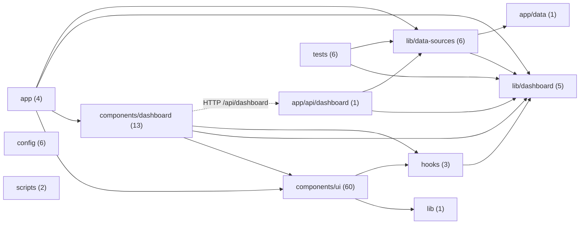

## Tabla de módulos

| Módulo | Enlace | Líneas | Dependencias directas |
|---|---|---|---|
| route.ts | [app/api/dashboard/route.ts](../app/api/dashboard/route.ts) | 16 | lib/dashboard/filters.ts, lib/data-sources/configured-dashboard-source.ts |
| cronograma.json | [app/data/cronograma.json](../app/data/cronograma.json) | 0 | — |
| globals.css | [app/globals.css](../app/globals.css) | 0 | — |
| layout.tsx | [app/layout.tsx](../app/layout.tsx) | 56 | app/globals.css |
| loading.tsx | [app/loading.tsx](../app/loading.tsx) | 19 | components/ui/skeleton.tsx |
| page.tsx | [app/page.tsx](../app/page.tsx) | 12 | components/dashboard/dashboard.tsx, lib/dashboard/filters.ts, lib/data-sources/configured-dashboard-source.ts |
| agency-card.tsx | [components/dashboard/agency-card.tsx](../components/dashboard/agency-card.tsx) | 113 | components/dashboard/agency-sparkline.tsx, components/dashboard/circular-progress.tsx, components/dashboard/stage-stepper.tsx, components/ui/badge.tsx, components/ui/card.tsx, lib/dashboard/types.ts |
| agency-columns.tsx | [components/dashboard/agency-columns.tsx](../components/dashboard/agency-columns.tsx) | 169 | lib/dashboard/tools.ts, lib/dashboard/types.ts |
| agency-sparkline.tsx | [components/dashboard/agency-sparkline.tsx](../components/dashboard/agency-sparkline.tsx) | 54 | hooks/use-hydrated.ts, lib/dashboard/types.ts |
| attention-panel.tsx | [components/dashboard/attention-panel.tsx](../components/dashboard/attention-panel.tsx) | 112 | lib/dashboard/tools.ts, lib/dashboard/types.ts |
| circular-progress.tsx | [components/dashboard/circular-progress.tsx](../components/dashboard/circular-progress.tsx) | 66 | — |
| dashboard-navigation.tsx | [components/dashboard/dashboard-navigation.tsx](../components/dashboard/dashboard-navigation.tsx) | 104 | — |
| dashboard-shell.tsx | [components/dashboard/dashboard-shell.tsx](../components/dashboard/dashboard-shell.tsx) | 222 | components/dashboard/dashboard-navigation.tsx, components/ui/button.tsx, components/ui/tabs.tsx, lib/dashboard/format.ts, lib/dashboard/types.ts |
| dashboard.tsx | [components/dashboard/dashboard.tsx](../components/dashboard/dashboard.tsx) | 2029 | components/dashboard/agency-card.tsx, components/dashboard/agency-columns.tsx, components/dashboard/agency-sparkline.tsx, components/dashboard/attention-panel.tsx, components/dashboard/dashboard-navigation.tsx, components/dashboard/dashboard-shell.tsx, components/dashboard/data-source-status.tsx, components/dashboard/operations-overview.tsx, components/dashboard/progress-milestones.tsx, components/dashboard/provider-filter.tsx, components/dashboard/stage-stepper.tsx, components/ui/badge.tsx, components/ui/button.tsx, components/ui/card.tsx, components/ui/chart.tsx, components/ui/input.tsx, components/ui/native-select.tsx, components/ui/table.tsx, components/ui/tabs.tsx, hooks/use-dashboard-refresh.ts, lib/dashboard/filters.ts, lib/dashboard/milestones.ts, lib/dashboard/tools.ts, lib/dashboard/types.ts |
| data-source-status.tsx | [components/dashboard/data-source-status.tsx](../components/dashboard/data-source-status.tsx) | 63 | lib/dashboard/format.ts, lib/dashboard/types.ts |
| operations-overview.tsx | [components/dashboard/operations-overview.tsx](../components/dashboard/operations-overview.tsx) | 335 | components/dashboard/dashboard-navigation.tsx, lib/dashboard/tools.ts, lib/dashboard/types.ts |
| progress-milestones.tsx | [components/dashboard/progress-milestones.tsx](../components/dashboard/progress-milestones.tsx) | 167 | components/ui/native-select.tsx, lib/dashboard/milestones.ts, lib/dashboard/types.ts |
| provider-filter.tsx | [components/dashboard/provider-filter.tsx](../components/dashboard/provider-filter.tsx) | 70 | components/ui/button.tsx |
| stage-stepper.tsx | [components/dashboard/stage-stepper.tsx](../components/dashboard/stage-stepper.tsx) | 66 | lib/dashboard/types.ts |
| use-dashboard-refresh.ts | [hooks/use-dashboard-refresh.ts](../hooks/use-dashboard-refresh.ts) | 71 | lib/dashboard/types.ts |
| use-hydrated.ts | [hooks/use-hydrated.ts](../hooks/use-hydrated.ts) | 12 | — |
| use-mobile.ts | [hooks/use-mobile.ts](../hooks/use-mobile.ts) | 24 | — |
| filters.ts | [lib/dashboard/filters.ts](../lib/dashboard/filters.ts) | 114 | lib/dashboard/types.ts |
| format.ts | [lib/dashboard/format.ts](../lib/dashboard/format.ts) | 22 | — |
| milestones.ts | [lib/dashboard/milestones.ts](../lib/dashboard/milestones.ts) | 54 | lib/dashboard/types.ts |
| tools.ts | [lib/dashboard/tools.ts](../lib/dashboard/tools.ts) | 132 | lib/dashboard/types.ts |
| types.ts | [lib/dashboard/types.ts](../lib/dashboard/types.ts) | 81 | — |
| configured-dashboard-source.ts | [lib/data-sources/configured-dashboard-source.ts](../lib/data-sources/configured-dashboard-source.ts) | 27 | lib/data-sources/dashboard-source.ts, lib/data-sources/excel-snapshot-source.ts, lib/data-sources/sharepoint-excel-source.ts |
| cronograma-columns.ts | [lib/data-sources/cronograma-columns.ts](../lib/data-sources/cronograma-columns.ts) | 30 | lib/data-sources/xlsx-reader.ts |
| dashboard-source.ts | [lib/data-sources/dashboard-source.ts](../lib/data-sources/dashboard-source.ts) | 10 | lib/dashboard/types.ts |
| excel-snapshot-source.ts | [lib/data-sources/excel-snapshot-source.ts](../lib/data-sources/excel-snapshot-source.ts) | 12 | app/data/cronograma.json, lib/dashboard/types.ts, lib/data-sources/dashboard-source.ts |
| sharepoint-excel-source.ts | [lib/data-sources/sharepoint-excel-source.ts](../lib/data-sources/sharepoint-excel-source.ts) | 532 | app/data/cronograma.json, lib/dashboard/types.ts, lib/data-sources/cronograma-columns.ts, lib/data-sources/dashboard-source.ts, lib/data-sources/xlsx-reader.ts |
| xlsx-reader.ts | [lib/data-sources/xlsx-reader.ts](../lib/data-sources/xlsx-reader.ts) | 163 | — |
| utils.ts | [lib/utils.ts](../lib/utils.ts) | 7 | — |
| next.config.ts | [next.config.ts](../next.config.ts) | 6 | — |
| package.json | [package.json](../package.json) | 0 | — |
| extract-cronograma.ps1 | [scripts/extract-cronograma.ps1](../scripts/extract-cronograma.ps1) | 0 | — |
| project-map.mjs | [scripts/project-map.mjs](../scripts/project-map.mjs) | 590 | — |
| dashboard-tools.test.mjs | [tests/dashboard-tools.test.mjs](../tests/dashboard-tools.test.mjs) | 145 | lib/dashboard/filters.ts, lib/dashboard/tools.ts, lib/data-sources/cronograma-columns.ts |
| date-format.test.mjs | [tests/date-format.test.mjs](../tests/date-format.test.mjs) | 45 | lib/dashboard/format.ts |
| filters.test.mjs | [tests/filters.test.mjs](../tests/filters.test.mjs) | 26 | lib/dashboard/filters.ts |
| history-index.test.mjs | [tests/history-index.test.mjs](../tests/history-index.test.mjs) | 23 | lib/dashboard/filters.ts |
| milestones.test.mjs | [tests/milestones.test.mjs](../tests/milestones.test.mjs) | 161 | lib/dashboard/milestones.ts |
| xlsx-reader.test.mjs | [tests/xlsx-reader.test.mjs](../tests/xlsx-reader.test.mjs) | 63 | lib/data-sources/xlsx-reader.ts |
| tsconfig.json | [tsconfig.json](../tsconfig.json) | 0 | — |
| vercel.json | [vercel.json](../vercel.json) | 0 | — |
| vite.config.ts | [vite.config.ts](../vite.config.ts) | 65 | .openai/hosting.json |
| vite.vercel.config.ts | [vite.vercel.config.ts](../vite.vercel.config.ts) | 21 | — |

## Resumen UI

Hay 60 archivo(s) en components/ui, agrupados en un nodo único.

## Uso de la CLI

- `--focus`: lee el grafo guardado en JSON y lo renderiza sin volver a analizar las fuentes.
- `--check`: recorre las fuentes del proyecto y valida el grafo sin escribir archivos ni modificarlo.
- Sin argumentos: regenera el grafo y su salida.
- Formatos opacos: JSON y CSS no se parsean, se listan como dependencias sin análisis interno.
